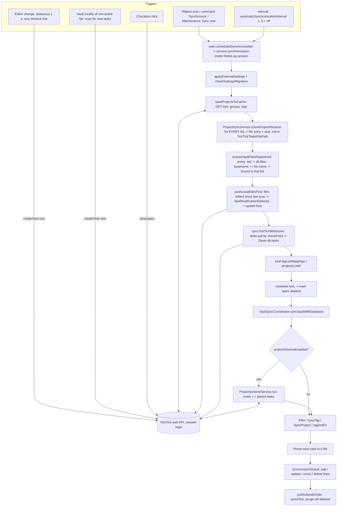
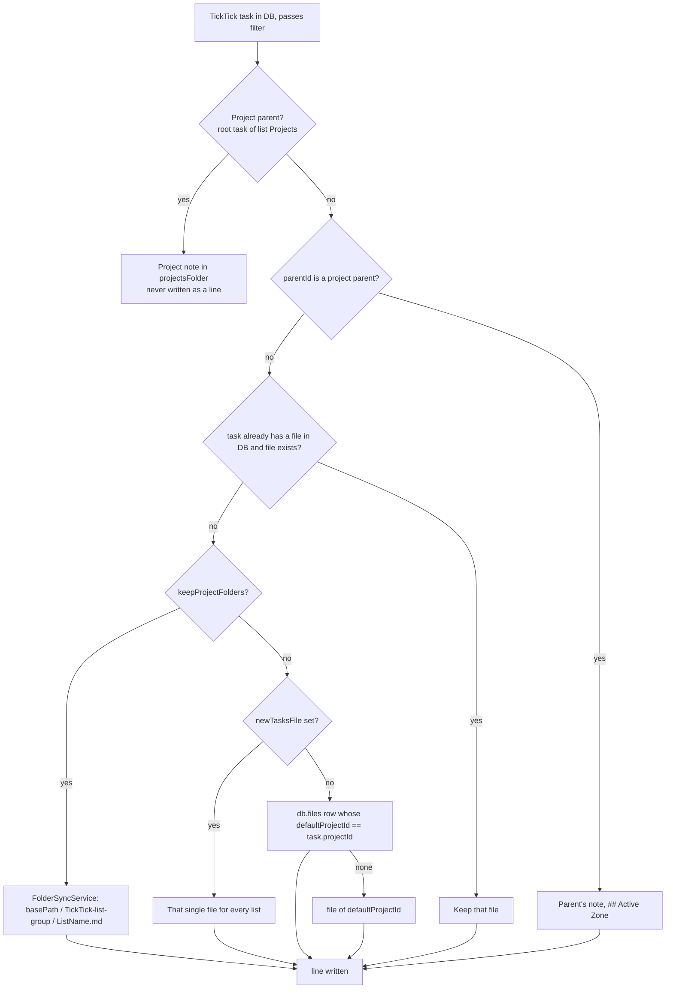

# GTD sync research — TickTickSync (Abyss fork) ⇄ Obsidian

**Date:** 2026-10-16 · **Branch:** `abyss-mapping` · **Test vault:** `/home/sam/obsidian/Thinkpad-tts-test` (copy; live vault untouched)
**Team:** Analyst 1 (plugin internals) · Analyst 2 (Obsidian / Abyss Tasks / GTD) · Product Owner (stories, ACs, priorities)
**Status:** research + pilot (2026-10-16). For step-by-step **real cases** (preconditions, expected vault + TickTick, pass/fail), use **`GTD_SYNC_CASES.md`**. This file stays the code-path and gap analysis.

> Facts below are from code and vault reads. Anything I could not verify without running Obsidian is marked **(unverified)**. No tokens or secrets are quoted. `data.json` was read only for non-secret keys.

---

## 0. Executive summary

1. **Root-level `Planned.md`, `waitingFor.md`, `Projects.md`, `Inbox.md`… are created for every TickTick list, not just synced ones.** `ProjectSyncService.checkProjectRename()` runs for each list on every sync and creates `<TickTickTasksFilePath>/<ListName>.md` (empty stub `== Added by TickTickSync -- 2.0.14 == `). `TickTickTasksFilePath` defaults to `/` (vault root), so the stubs land there. `SyncTag`/`SyncProject` do **not** stop this. The test vault has 11 such empty stubs plus numbered ones (`2.md`, `4.md`, `10.md`…, probably lists named with numbers).
2. **"Only sync notes in folder" does not exist as a setting.** Scope today is by TickTick side only (`SyncTag`, `SyncProject`, a single list) and by the `#ticktick` marker on the vault side. Nothing limits sync to a vault folder or to several lists.
3. **A working config-only path exists today:** `TickTickTasksFilePath` = a subfolder, `tagListMappings`, `projectSchemeEnabled` + `projectsListName`, `fileLinksInTickTick=noLink`, `stopInjectingTickTickTag=true`. It still creates a stub for every list inside that subfolder. Several keys it needs (`newTasksFile`, `projectsFolder`, `projectsListName`, `projectTaskTags`, `syncMarkerTag`) are **not in the settings UI**; they exist only in `data.json`.
4. **Recommended model: "R" = Hypothesis A (list files in one folder) + B's tag semantics (tag decides list, context tags become TickTick tags) + project scheme for GTD projects.** MVP needs 3 small code changes: a list allow-list, no stub files for non-synced lists, and a push scope. See §8.
5. **Safety warning:** the test vault `data.json` right now has `SyncTag=""`, `SyncProject=""`, `projectSchemeEnabled=false`, `keepProjectFolders=true`. `PO_STATUS.md` §2 says it was hardened to `SyncTag=tts-test` and scheme on. **Do not press Sync now** until this drift is explained (§3.7).

---

## 1. Product Owner — user story and acceptance criteria

### 1.1 Story (restated)

> As a GTD user of Obsidian (Abyss Tasks) and TickTick, I want two sync objects — **tasks** and **projects** — mapped by configuration (folder/tag ↔ list/tag, both directions), so that TickTick stays my phone/inbox surface and Obsidian stays my thinking surface, without junk files in the vault root and without surprises in my TickTick account.

### 1.2 Acceptance criteria

| # | Criterion (testable) | Today |
|---|---|---|
| AC-1 | **Safe start.** Enable plugin → no network write, no file created. First sync with no scope configured does nothing (or asks). | Partial: interval `0`, no sync on load (CHANGELOG 04:10). Empty scope = **sync everything**. |
| AC-2 | **No root clutter.** All list files live under one configured tasks folder (e.g. `30 Tasks/TickTick/`). | Partial: `TickTickTasksFilePath` (UI: Sync Control → Defaults). |
| AC-3 | **Only chosen lists** get files and pulled tasks (e.g. Inbox, nextAction, Planned, waitingFor, someDay, Projects). | **No.** Only one `SyncProject` or one `SyncTag`. |
| AC-4 | **Project Obsidian → TT.** A note in `10 Projects/` with tag `system/project` creates one parent task in list `Projects` (tags `project`, `obsidian`); `ticktick_id` written to frontmatter; a second sync creates no duplicate. | Yes (pilot), but built-in template only. |
| AC-5 | **Project TT → Obsidian.** A new root task in `Projects` creates one note from the project template in `10 Projects/`; its subtasks appear under `## Active Zone`. | Yes (pilot), template is hard-coded (`renderProjectNote`), not the user's `60 templates/MOC.md`. |
| AC-6 | **Subtasks, notes, comments both ways** in Abyss format (`- > ` description, `- ` comment). | Yes for line tasks (`abyssTasksFormat`). Project *note body* (Overview) is filled once at creation, never synced back. |
| AC-7 | **Inline vault task → TT.** A line with the sync marker goes to the list chosen by its GTD tag (`#type/next` → nextAction); context tags (`#context/work`) become TickTick tags; no GTD tag → configured default list. | Yes via `tagListMappings` + `tagMappings`; default list = `defaultProjectId` or Inbox. |
| AC-8 | **TT task → Obsidian.** A task in a synced list appears in that list's file under the tasks folder; moving it to another list in TickTick moves/retags the line. | Yes for per-list files; with `tagListMappings` the tag is rewritten. |
| AC-9 | **Source tag.** After sync a line shows `#ticktick` (came from TT) or `#obsidian` (born in vault). | **Partial / suspect**, see §3.6 R1. |
| AC-10 | **No pollution.** No file links in TickTick titles; no `ticktick` tag pushed to TickTick. | Needs `fileLinksInTickTick=noLink`, `stopInjectingTickTickTag=true` — defaults are the opposite. |
| AC-11 | **Reversible.** One action undoes the last sync. | Yes (redo log: undo-last-sync, dry-run preview — commit `11df207`). |
| AC-12 | **Clear settings.** Every setting that decides a path, list or tag is visible in the UI with a one-line "what happens" text. | **No.** Six keys that decide paths/lists are `data.json`-only (G4). |

### 1.3 Gaps vs current plugin (with evidence)

| ID | Gap | Evidence (file / symbol) | Severity |
|---|---|---|---|
| G1 | Stub file for **every** TT list, ignoring filters | `ProjectSyncService.checkProjectRename` (called for all lists in `saveProjectsToCache`); `VaultSyncCoordinator.ensureProjectFilesExist` re-creates deleted ones | High — the "mess" |
| G2 | No multi-list allow-list | `syncModule.ts` filter block (~L70–130) and `VaultSyncCoordinator.matchesFilter`: one `SyncProject` and/or one `SyncTag` | High |
| G3 | Empty filters = mirror entire account | same blocks: `if (!syncTag && !syncProject) return true` | High (caused the first-sync pollution) |
| G4 | Settings not in UI: `newTasksFile`, `projectsFolder`, `projectsListName`, `projectTaskTags`, `syncMarkerTag`, `projectsListId` | grep in `src/ui` → none | High |
| G5 | Reverse `projectMappings` (TT list → file) is **dead code** | `FileTaskQueries.getFilepathForProject` (only user of `pathForProjectId`) has no callers; pull routing uses `FileMetadataService.getFilepathForProjectId`, which ignores `projectMappings`. `ABYSS_MAPPING.md` row "note in projects/X.md → list X" claims reverse is done — only forward (`getDefaultProjectIdForFilepath`) is wired | Medium |
| G6 | Project note template is built in | `projectScheme.renderProjectNote`; no `projectTemplatePath` setting | Medium |
| G7 | Project scheme ignores `SyncTag`: **every** open root task of list `Projects` becomes a note | `ProjectSchemeService.run` gets all DB tasks (`VaultSyncCoordinator.syncVaultWithDatabase`), `isListRoot` | High for tests; isolate with `projectsListName` |
| G8 | No vault-side scope ("only folder X") | no key; push is driven by `#ticktick` marker or `enableFullVaultSync` (whole vault) | Medium |
| G9 | Notes named like a list get bound to that list **anywhere** in the vault | `index.ts registerNewVaultFile`: `allProjects.find(p => p.name === file.basename)` → `upsertFile(path, projectId)` | Medium (a note called `Projects.md` or `Inbox.md` is captured) |
| G10 | Parent-task description/comments are not synced after note creation | `ProjectSchemeService.run`: `content` used only in `createNote`; no `setNoteBody` action in `planProjects` | Medium |
| G11 | `keepProjectFolders` builds subfolders from TickTick **list groups** | `FolderSyncService.getFolderPathForProject`; test vault has it `true` | Low–Medium (confusing paths) |
| G12 | `#ticktick` marker clashes with Abyss "inbox = untagged" | Abyss `data.json`: `inbox.mode = "untagged"`; pulled lines always carry `#ticktick` (`convertTaskToLine → addTickTickTag`) | Medium (TT inbox tasks do not show in Abyss Inbox) |
| G13 | Abyss project membership is default `projects/`, vault uses `10 Projects/` | test vault `.obsidian/plugins/abyss-tasks/data.json` → `projects.membershipQuery = "projects/"` | Low (vault config, not plugin) |

### 1.4 MVP configuration surface (prioritised)

| Priority | Setting (existing key / **NEW**) | Why |
|---|---|---|
| **Must** | `TickTickTasksFilePath` (tasks folder) | kills root clutter (AC-2) |
| **Must** | **NEW `syncedLists`** (names/ids) replaces single `SyncProject` | AC-3, AC-1 |
| **Must** | `tagListMappings` table (GTD tag ↔ list) | AC-7/8 |
| **Must** | `projectSchemeEnabled`, `projectsFolder`, `projectsListName` in UI | AC-4/5/12 |
| **Must** | `fileLinksInTickTick=noLink`, `taskLinksInObsidian=noLink`, `stopInjectingTickTickTag=true` as new defaults for this fork | AC-10 |
| **Should** | **NEW `syncScopeFolders`** (push only from these folders) | G8, "only sync notes in folder" |
| **Should** | **NEW `projectTemplatePath`** | G6 |
| **Should** | `tagMappings` (context tags) | AC-7 |
| **Should** | Fix source-tag semantics (R1) | AC-9 |
| **Could** | `newTasksFile` hub mode in UI | Hypothesis B fallback |
| **Could** | Folder → list mapping UI (`projectMappings`) incl. reverse | G5 |
| **Won't (now)** | Per-project TickTick folders, task-note ⇄ TT task, parent description two-way | scope |

---

## 2. Analyst 2 — Obsidian / Abyss Tasks / GTD model

### 2.1 How "project" is defined — two definitions that must agree

| Layer | Definition | Where |
|---|---|---|
| **This vault (user's)** | A **project MOC note**: frontmatter `tags: [system/moc, system/project]`, `kind: system`, `status: 🟢 In Progress`, `areas`, `topic`; sections `## Overview`, `## Основные разделы`, `## Active Zone`, `## Источники и связанные заметки`, `> [!note] Metadata`. Lives in `10 Projects/`. Created by Templater `60 templates/MOC.md` (kind chosen by prompt; `system/project` tag only for "project MOC"). | `/home/sam/obsidian/Thinkpad-tts-test/60 templates/MOC.md`; example `10 Projects/Подключение посудомойки.md` |
| **Abyss Tasks plugin (generic)** | A **note matching `projects.membershipQuery`** (syntax: `folder/`, `#tag`, `key=value`, `and/or/not`). Default `"projects/"`, `createFolder: "projects"`, `statusProperty: "status"`, statuses inbox/todo/wip/done, new tasks go under section `# Tasks` (`taskInsertionMode: "section"`). | `.obsidian/plugins/abyss-tasks/data.json` → `projects.*` (v2.1.2) |
| **TickTickSync fork** | Note with frontmatter tag `system/project` **and** path under `projectsFolder` (default `10 Projects`); identity = frontmatter `ticktick_id`; tasks go to `## Active Zone`. | `src/projectScheme.ts` `isProjectNote`, `ACTIVE_ZONE`, `renderProjectNote` |

**Mismatch to fix in vault config (not in plugin):** Abyss `membershipQuery` is `projects/` but projects live in `10 Projects/`. Suggest `10 Projects/` (or `#system/project`) and `projects.taskInsertionSection` = the Active Zone heading, so tasks created from the Abyss UI land where the plugin looks. **(unverified)** — check Abyss section-heading syntax in its settings UI.

### 2.2 Object glossary (settles "task notes vs project notes")

| Object | What it is in this vault | Synced to TickTick? |
|---|---|---|
| **Inline task** | Markdown checkbox line anywhere (`- [ ] …`), Abyss format, tags carry GTD/context | **Yes, if it carries the sync marker `#ticktick`** (`settings.syncMarkerTag`) or full-vault sync is on |
| **Project note** (MOC) | `10 Projects/X.md`, tag `system/project` | **Yes**: one parent task in list `Projects` (scheme, pilot) |
| **Task note** | One note per bigger task: `60 templates/task.md` → frontmatter `task: [[X]]`, `project:`, `status: backlog/done`, `priority`, `deadline`, tags `task` + `work`; lives in `30 Tasks/30x …/` (e.g. `DON-109.md`); has `## Subtasks` checkboxes | **No note-level sync.** Its checkbox lines sync like inline tasks; if frontmatter `project:` links a project note they become children of that project (`ProjectSchemeService.resolveForFile`) |
| **Dashboards** | `10 Projects/Dash.projects.base`, `30 Tasks/Dash.tasks.base` (Bases views on `status`, `project`, `deadline`) | No — read-only views over notes |

Decision proposal (PO): **a project note is a GTD project; a task note is documentation for a task; the TickTick task is the checkbox line.** Do not try to mirror task notes into TickTick in MVP.

### 2.3 Active Zone, MOC, status

- `## Active Zone` is where open work lives in the MOC template (checkboxes + open questions/insights). The plugin inserts new project subtasks at the **end of that section** (`activeZoneInsertLine`).
- Project status: frontmatter `status` (`🟢 In Progress` / `✅ Done`). `isDoneStatus` matches `done|✅|заверш|выполн`. 3-way merge with TickTick completion via `settings.projectSnapshot`.
- MOC `Metadata` callout (`Source::`, `Next::`) — plugin writes `Source:: TickTick` only for notes it creates; the **source tag** (`ticktick` or `obsidian`) is stamped into frontmatter `tags` (`stampSourceTags`).

### 2.4 How inline tasks get list/context from tags

- Abyss Tasks itself: tags on the line group tasks; **Inbox = untagged tasks** (`inbox.mode: "untagged"`, `removeTagOnAssign: true`). `taskFilePath` default `tasks/active.md`. Statuses ` `, `/`, `x`, `-`.
- In this vault, GTD state is expressed as tags (`#type/next` is the example used in `ABYSS_MAPPING.md` step 4 and `PO_STATUS.md`; `#context/work` for context). Real usage count in the test vault is tiny, so **the tag taxonomy is a user decision** (§9 Q1).
- Plugin side (code): `listMapping.ts` + `taskParser.convertLineToTask` — first tag found in `tagListMappings` picks the TickTick list; that tag is **not** sent as a TickTick tag. `tagMapping.ts` maps other Obsidian tags ↔ TickTick tags. Unmapped tags go through hierarchy logic `foo/bar` ⇄ `foo-bar` (`tagPathMap`, Abyss mode only). A tag whose text equals a **list name** (underscores/slashes → spaces) also routes to that list (taskParser ~L698–711) when no mapping exists.
- Consequence for Abyss: the sync marker `#ticktick` is a tag, so a pulled inbox task is no longer "untagged" (G12). Options: give Abyss inbox `mode: "tag"` with tag `inbox`, or keep marker out of Abyss logic via `taskIgnoreQuery` **(unverified)**.

---

## 3. Analyst 1 — how TickTickSync works today

### 3.1 Data flow



Notes:
- **Auth:** unofficial web session (`AccessControlLogin.svelte` → `getTick({baseUrl, token, checkPoint})`); stored in plugin `data.json` (`token`, `inboxID`). It is **not** the Open API `tp_…` token; the MCP uses a separate OAuth.
- **Pull** = delta by `checkPoint` into Dexie (`db.tasks`), then **filter**, then write lines. **Push** = (a) before every pull, files edited since last sync (`pushLocalEditsFirst`), (b) live on editor change / file modify / checkbox click.
- `ProjectSchemeService.run` is invoked **twice** per sync (`syncModule` after the delta, and at the top of `syncVaultWithDatabase`) — idempotent but wasteful.
- Journal/undo: every sync runs inside `RedoLog.session('sync')` (`src/redo/*`).

### 3.2 List → file routing (pull)



Path actually built for a new list: `getDefaultFolder()` (`TickTickTasksFilePath` without slashes; `''` for `/`) + optional group folder + `sanitize(listName).md` (`ProjectSyncService.checkProjectRename`). Duplicate list names open a modal and **abort** the project cache save.

### 3.3 Routing push (vault line → TickTick list)

Priority in `taskParser.convertLineToTask` (first match wins):
1. Parent line's list (a subtask always stays with its parent).
2. Project scheme: line inside a project note, or in a note whose `project:` frontmatter links to one → parent = project parent, list = `Projects`.
3. `tagListMappings` (first mapped tag).
4. Tag equal to a list name.
5. `FileTaskQueries.getDefaultProjectIdForFilepath`: `db.files.defaultProjectId` → `projectMappings` (exact file, else longest folder prefix) → `settings.defaultProjectId` → `inboxID`.

### 3.4 Parent/child

- Real TickTick subtasks ⇄ indented checkbox lines (`parentId`/`childIds`; order via `sortOrder`, `subtaskOrder.ts`).
- Checklist items ⇄ indented checkboxes with item ids.
- Abyss children (`- > ` description, `- ` comment) ⇄ TickTick `content`/`desc`; comments after a literal line `Comments:` (`abyssFormat.ts`).
- Project scheme: parent never a line; children route to the project note.

### 3.5 Settings → what each controls

UI = where the user can set it. "—" = **`data.json` only**.

| Key | Default (`DEFAULT_SETTINGS`) | Controls | UI |
|---|---|---|---|
| `automaticSynchronizationInterval` | `0` | seconds between auto syncs; 0 = none | Sync Control → Auto interval |
| `enableFullVaultSync` | `false` | every checkbox in the vault is pushed (adds the marker); also disables the live editor-change check | Sync Control → Full vault sync (confirm dialog) |
| `SyncTag` | `''` | pull only tasks with this TickTick tag (`/`→`-`, lowercase) | Sync Control → Limit |
| `SyncProject` | `''` | pull only this one list | Sync Control → Limit |
| `tagAndOr` | `1` | AND/OR between tag and project | Sync Control → Limit |
| `TickTickTasksFilePath` | `'/'` | folder for **list files** (root when `/`) | Sync Control → Defaults |
| `defaultProjectId` / `defaultProjectName` | `''` / `Inbox` | list for lines with no other hint; also fallback file | Sync Control → Defaults |
| `keepProjectFolders` | `false` | adds a subfolder per TickTick **list group** | Task Settings |
| `newTasksFile` | `''` | single hub file for all lists; suppresses stubs and renames | **—** |
| `syncMarkerTag` | `ticktick` | tag that marks "this line is synced" | **—** |
| `stopInjectingTickTickTag` / `stripTickTickTagOnReset` | `false` / `false` | whether `ticktick` is pushed as a real TickTick tag | Task Settings |
| `fileLinksInTickTick` | `taskLink` | appends `obsidian://` link to **TickTick titles** | Task Settings (+ Debug) |
| `taskLinksInObsidian` | `taskLink` | appends TickTick link to the vault line | Task Settings |
| `syncNotes`, `noteDelimiter` | `true`, `----…` | notes (content) sync | Notes |
| `abyssTasksFormat`, `abyssIndent` | `false`, `tab` | Abyss `- > ` / `- ` child lines | Notes |
| `statusMappings` | `/`→`status/in-progress`, `-`→`status/cancelled` | checkbox char ⇄ TickTick tag | Notes |
| `tagMappings` | `[]` | Obsidian tag ⇄ TickTick tag | Notes |
| `tagListMappings` | `[]` | Obsidian tag → TickTick list (list wins over file) | Notes |
| `projectMappings` | `[]` | file/folder → list (push direction only is wired) | Notes |
| `scheduledAsStartDate` | `false` | ⏳ ⇄ TickTick start date | Notes |
| `onTickTickDeletion` | `ask` | modal vs `[-]` + detach | Notes |
| `autoCleanupDatabase` | `false` | forget deleted files without asking | Notes |
| `projectSchemeEnabled` | `false` | project notes ⇄ parent tasks | Notes ("pilot") |
| `projectsFolder` | `10 Projects` | folder that holds project notes | **—** |
| `projectsListName` / `projectsListId` | `Projects` / auto | which list holds project parents | **—** |
| `projectTaskTags` | `['project','obsidian']` | tags on created parent tasks | **—** |

### 3.6 What "only sync notes in folder" does (and does not)

- There is **no** such setting. The nearest things:
  - `TickTickTasksFilePath` ("Default folder") — only **where list files are created**; says nothing about which tasks sync.
  - `SyncProject` / `SyncTag` ("Limit synchronization") — filters what is **pulled from TickTick**. It does not stop stub creation (G1) or the Projects scheme (G7).
  - The `#ticktick` marker — what the vault side **pushes**; any note in the vault can contribute.
  - `projectsFolder` — scope for **project notes only**.
- Why root files appear: `TickTickTasksFilePath='/'` + stub for every list + `ensureProjectFilesExist` re-creating anything you delete + (G9) any note whose basename equals a list name is adopted as that list's file.

**Open code risks to verify in a soak (not fixed here):**
- **R1 source tag / marker (unverified).** `hasTickTickTag` requires `#ticktick` (marker) on the line. `convertTaskToLine` skips adding the marker for project children that carry `#obsidian`, and `convertLineToTask` adds `#obsidian` only when no source tag is present — yet a line is only detected when it already has the marker. So `#obsidian` lines may be invisible to `addNewTask` / `checkLineForModifications`. Test T-A6 below.
- **R2** hub mode: task from an unmapped list pulled into `newTasksFile` has no list tag; editing it may push `projectId = default list` (moves it to Inbox). Test T-B5.
- **R3** scheme `createNote` for **every** open root in `Projects` regardless of `SyncTag`.
- **R4** `projectSnapshot` keeps state in `data.json` only.

### 3.7 Test vault state (read-only look)

| Item | Value in `Thinkpad-tts-test/.obsidian/plugins/tickticksync/data.json` |
|---|---|
| `SyncTag` / `SyncProject` | `""` / `""` → **unlimited** |
| `projectSchemeEnabled` | `false` (PO_STATUS says on) |
| `keepProjectFolders` | `true` |
| `TickTickTasksFilePath` | `/` |
| `automaticSynchronizationInterval` | `0` |
| `abyssTasksFormat` / `fileLinksInTickTick` / `taskLinksInObsidian` / `stopInjectingTickTickTag` | `true` / `noLink` / `noLink` / `true` |
| `tagListMappings`, `tagMappings`, `projectMappings`, `newTasksFile` | empty |
| Root stubs | `Inbox.md KB.md nextAction.md Planned.md someDay.md waitingFor.md` (0 lines), `Projects.md` (1 line), numbered `2…21.md`, `HappyBirthdays.md`, `Index.md`, `physical environment.md` |
| `10 Projects/` | 16 project notes with `ticktick_id` (from the earlier scheme run) |

Likely cause of drift (login code only sets `token`, `inboxID`, `checkPoint`): the settings UI saves its in-memory snapshot over a hand-edited `data.json` or the vault copy was refreshed. **Cause not found in code** — open item.

---

## 4. Hypothesis A — list-centric

### 4.1 Model definition

| Aspect | Definition |
|---|---|
| Vault folders | `30 Tasks/TickTick/` holds **one file per synced TickTick list**; `10 Projects/` holds project notes |
| Files | `Inbox.md`, `nextAction.md`, `Planned.md`, `waitingFor.md`, `someDay.md` (names = TickTick list names) |
| TickTick lists | Same names, plus `Projects` (parents only) |
| Project representation | Project note ⇄ parent task in `Projects`; subtasks in `## Active Zone` |
| Inline task routing | marker + **GTD tag → list** (`tagListMappings`); else the file's list (`projectMappings` / db default); else Inbox |
| Context | `#context/*` ⇄ TickTick tags (`tagMappings`) |
| Source tag | `#ticktick` on pulled lines; `#obsidian` target for vault-born (R1) |

### 4.2 Plan

Settings (config-only part, works today):

```json
{
  "TickTickTasksFilePath": "30 Tasks/TickTick",
  "keepProjectFolders": false,
  "newTasksFile": "",
  "tagListMappings": [
    {"tag": "type/next",     "list": "nextAction"},
    {"tag": "type/planned",  "list": "Planned"},
    {"tag": "type/waiting",  "list": "waitingFor"},
    {"tag": "type/someday",  "list": "someDay"}
  ],
  "projectSchemeEnabled": true,
  "projectsFolder": "10 Projects",
  "projectsListName": "Projects"
}
```

Needs code: allow-list (G2) and no stubs for other lists (G1) — otherwise every TickTick list still gets an empty file in `30 Tasks/TickTick/`.

### 4.3 Test plan (test vault, isolated TickTick test lists)

Preconditions (do once):
1. TickTick backup exists (`ticktick-backup-*.csv` in vault root). Keep the plugin **disabled** while editing `data.json`.
2. In TickTick create test lists via MCP: `TTS-nextAction`, `TTS-Planned`, `TTS-Projects`. Tag 3 test tasks `tts-test` (one per `TTS-*` list except Projects).
3. Move/delete the 11 empty root stubs in the test vault copy (they are empty).
4. `data.json`: A-config above with `tagListMappings` pointing at the `TTS-*` lists (e.g. `type/next = TTS-nextAction`), `projectsListName=TTS-Projects`, `SyncTag=tts-test`, `fileLinksInTickTick=noLink`, `taskLinksInObsidian=noLink`, `stopInjectingTickTickTag=true`, interval `0`.

| Step | Action | Expected |
|---|---|---|
| A1 | Enable plugin, Sync now | `30 Tasks/TickTick/` exists; **no new root `.md`**; 3 test tasks appear in the files of their `TTS-*` lists; **known:** empty stubs for every other list also appear inside `30 Tasks/TickTick/` (G1) |
| A2 | In `00 Inbox/TTS-Test.md` add `- [ ] A2 inline #type/next #context/work #tts-test #ticktick` | within ~1 s a new TickTick task in `TTS-nextAction`, tags `work`, `tts-test`; no `ticktick` tag; no link in title; line gains `%%[ticktick_id:: …]%%` |
| A3 | MCP: `move_task` A2 to `TTS-Planned`; Sync now | line moves to `TTS-Planned.md`; tag `#type/next` replaced by `#type/planned` only if mapping exists for Planned |
| A4 | MCP: create parent `TTS-proj-1` in `TTS-Projects`; Sync now | one note `10 Projects/TTS-proj-1.md` with `system/project`, `ticktick_id`, tag `ticktick`; no line for the parent |
| A5 | Create note `10 Projects/TTS-proj-2.md` with tags `system/moc`, `system/project`; Sync now | parent `TTS-proj-2` in `TTS-Projects`, tags `project`, `obsidian`; frontmatter gets `ticktick_id`; second Sync creates **no** duplicate |
| A6 | In `TTS-proj-2.md` under `## Active Zone` add `- [ ] child #ticktick`; Sync / wait | TickTick subtask of `TTS-proj-2`; **then** add `- [ ] child2` (no marker) — expect not pushed (documents marker rule); edit child text and Sync — check R1 |
| A7 | Mark note `status: ✅ Done`; Sync | parent completed in TickTick; reverse: reopen in TickTick → note status back to `🟢 In Progress` |
| A8 | Rename note in vault; Sync | parent title in TickTick renamed (`planTitle`) |
| A9 | Undo last sync (redo-log command) | vault lines reverted; TickTick tasks created in the session removed **(unverified for TT side)** |

Pass: no file written outside `30 Tasks/TickTick/`, `10 Projects/`, `00 Inbox/TTS-Test.md`; TickTick account diff limited to `TTS-*` objects.

### 4.4 Pros / cons for a human GTD user

| Pros | Cons |
|---|---|
| Mirrors TickTick: one file ≙ one list, easy to reason about | One empty stub per **other** list unless G1 is fixed |
| Per-file default list: typing in `Planned.md` needs no tag | Moving a task between lists = moving a line between files (churn in git/sync) |
| Existing code paths, least new logic | `projectMappings` reverse is dead (G5); folder groups can add surprise subfolders |
| Abyss queries by tag still work | Many small files; Abyss "inbox = untagged" conflicts with `#ticktick` |

---

## 5. Hypothesis B — project-centric / few hubs

### 5.1 Model definition

| Aspect | Definition |
|---|---|
| Vault folders | `30 Tasks/TickTick/` with **one hub** `Tasks.md` (`newTasksFile`); `10 Projects/` project notes |
| TickTick lists | Same GTD lists; list identity lives in **tags** inside the vault (`#type/next` ↔ `nextAction`) |
| Project representation | Only via scheme; project tasks never in the hub |
| Inline routing | tag → list; **no tag → default list** |
| Unmapped lists | their tasks arrive in the hub **without** a list tag (R2) |

### 5.2 Plan

```json
{
  "newTasksFile": "30 Tasks/TickTick/Tasks.md",
  "TickTickTasksFilePath": "30 Tasks/TickTick",
  "keepProjectFolders": false,
  "tagListMappings": [
    {"tag": "type/next",    "list": "nextAction"},
    {"tag": "type/planned", "list": "Planned"},
    {"tag": "type/waiting", "list": "waitingFor"},
    {"tag": "type/someday", "list": "someDay"}
  ],
  "projectSchemeEnabled": true,
  "projectsFolder": "10 Projects",
  "projectsListName": "Projects"
}
```

`newTasksFile` is **not in the UI**; edit `data.json`. With it set: `FileMetadataService.getFilepathForProjectId` returns the hub for every list, `checkProjectRename` returns before creating stubs, `ensureProjectFilesExist` returns early, and list moves do not relocate lines.

### 5.3 Test plan

Same preconditions as §4.3 (steps 1–4), plus hub config.

| Step | Action | Expected |
|---|---|---|
| B1 | Sync now | **zero** new files except `Tasks.md`; the 3 `tts-test` tasks sit in `Tasks.md`, each with its list tag (`#type/next`, `#type/planned`) |
| B2 | Add `- [ ] B2 #type/waiting #tts-test #ticktick` in hub | TickTick task in list mapped to `waiting` |
| B3 | MCP: move B2 to `TTS-nextAction`; Sync | line stays in place; tag `#type/waiting` → `#type/next` |
| B4 | Project tests A4–A8 | identical to A |
| B5 | Pull a task from an **unmapped** list (add a `tts-test`-tagged task in a list with no mapping), edit its text in the vault, Sync | list in TickTick must **not** change; if it jumps to Inbox → defect R2 |
| B6 | Delete the hub line, Sync | `onTickTickDeletion` applies; check TickTick task deleted vs asked |

### 5.4 Pros / cons for a human GTD user

| Pros | Cons |
|---|---|
| No file clutter at all; one place to review | One long file; weak Abyss per-file context; merge conflicts if synced via Livesync |
| Moves between lists = tag swap, no line relocation | Unmapped lists lose identity; R2 risk |
| Config-only today | Hub path not in UI; GTD "Planned.md" files the user explicitly named do not exist |

---

## 6. Recommended solution R — "A files + B tags + projects via scheme"

**Rule:** TickTick **list** = GTD state (decided by tag on push, by list on pull). **TickTick tag** = context/source. **Project** = note ⇄ parent task. Everything outside an allow-list is invisible to the plugin.

### 6.1 Target vault tree

```
00 Inbox/                   capture notes; not touched by sync (except lines you mark)
10 Projects/                project MOC notes (system/project) ⇄ TickTick Projects parents
    1000 Архив/             archived projects (not synced back; see Q6)
30 Tasks/
    TickTick/               ← TickTickTasksFilePath; ONLY allow-listed lists
        Inbox.md
        nextAction.md
        Planned.md
        waitingFor.md
        someDay.md
    301 Noveo_tasks/ …      task notes (Abyss), NOT synced as objects
60 templates/               MOC.md (project), task.md
```

### 6.2 Target TickTick structure

- Optional list group **GTD** containing `nextAction`, `Planned`, `waitingFor`, `someDay` (keep `keepProjectFolders=false` so the group does not create a subfolder).
- Built-in `Inbox`.
- List `Projects`: root tasks = projects (tags `project`, `obsidian`); subtasks = project actions.
- Everything else (`KB`, `HappyBirthdays`, `Index`, numbered lists…) is **not** synced.

### 6.3 Default settings (safe) — JSON snippet

`syncedLists`, `syncScopeFolders`, `projectTemplatePath` are **NEW keys to implement**; the rest exist.

```json
{
  "automaticSynchronizationInterval": 0,
  "enableFullVaultSync": false,
  "SyncTag": "",
  "SyncProject": "",
  "syncedLists": ["Inbox", "nextAction", "Planned", "waitingFor", "someDay", "Projects"],
  "syncScopeFolders": ["00 Inbox/", "10 Projects/", "30 Tasks/"],
  "TickTickTasksFilePath": "30 Tasks/TickTick",
  "keepProjectFolders": false,
  "newTasksFile": "",
  "defaultProjectName": "Inbox",
  "syncNotes": true,
  "abyssTasksFormat": true,
  "abyssIndent": "tab",
  "fileLinksInTickTick": "noLink",
  "taskLinksInObsidian": "noLink",
  "stopInjectingTickTickTag": true,
  "stripTickTickTagOnReset": false,
  "syncMarkerTag": "ticktick",
  "onTickTickDeletion": "ask",
  "autoCleanupDatabase": false,
  "tagListMappings": [
    {"tag": "type/next",    "list": "nextAction"},
    {"tag": "type/planned", "list": "Planned"},
    {"tag": "type/waiting", "list": "waitingFor"},
    {"tag": "type/someday", "list": "someDay"}
  ],
  "tagMappings": [
    {"obsidian": "context/work", "ticktick": "work"},
    {"obsidian": "context/home", "ticktick": "home"}
  ],
  "projectMappings": [
    {"path": "30 Tasks/TickTick/Inbox.md", "project": "Inbox"},
    {"path": "30 Tasks/TickTick/Planned.md", "project": "Planned"}
  ],
  "projectSchemeEnabled": false,
  "projectsFolder": "10 Projects",
  "projectsListName": "Projects",
  "projectTaskTags": ["project", "obsidian"],
  "projectTemplatePath": "60 templates/MOC.md"
}
```

Safety notes: `projectSchemeEnabled` ships `false` until the Projects-only soak (PO_STATUS §4) passes. `onTickTickDeletion: "ask"` is safer than `cancel` while testing. No auto sync on load: interval `0` and the enable-time sync was removed (CHANGELOG 2026-10-16 04:10). Live push on edit still happens for lines carrying the marker; `syncScopeFolders` (new) is the guard for that.

### 6.4 Mapping table — Obsidian → TickTick

| Obsidian location / tag | TickTick object | Notes |
|---|---|---|
| Note in `10 Projects/` tagged `system/project` | Parent task in list `Projects`, tags `project`, `obsidian` | title = note basename; `status` ⇄ completion |
| Line under `## Active Zone` of a project note, marker `#ticktick` | Subtask of that parent | list stays `Projects` |
| Line in a task note with frontmatter `project: [[X]]` | Subtask of project X | task note itself is **not** a TickTick task |
| Line with `#type/next` (+ marker) anywhere in scope | Task in list `nextAction` | tag is consumed (not sent as TickTick tag) |
| …`#type/planned` / `#type/waiting` / `#type/someday` | `Planned` / `waitingFor` / `someDay` | |
| Line in `30 Tasks/TickTick/Planned.md` with no GTD tag | `Planned` | via `projectMappings` / file default |
| Line with marker, no GTD tag, outside list files | `defaultProjectId` → `Inbox` | |
| `#context/work` | TickTick tag `work` | via `tagMappings` |
| Other tags `foo/bar` | TickTick tag `foo-bar` | hierarchy rule, `tagPathMap` |
| `[/]` / `[-]` | tags `status/in-progress` / `status/cancelled` | `statusMappings` |
| `- > text` / `- text` under task | TickTick note / `Comments:` section | Abyss format |
| `#ticktick` marker | "synced line" flag; **not** pushed as TickTick tag | `stopInjectingTickTickTag=true` |

### 6.5 Reverse mapping — TickTick → Obsidian

| TickTick | Obsidian |
|---|---|
| Root task in `Projects` | `10 Projects/<title>.md` from template; tags + source tag `ticktick`; frontmatter `ticktick_id` |
| Subtask of that parent | line under `## Active Zone`, marker `#ticktick` |
| Task in `nextAction` / `Planned` / `waitingFor` / `someDay` | line in `30 Tasks/TickTick/<list>.md` **and** tag `#type/*` (so it survives a move to another file) |
| Task in `Inbox` | `30 Tasks/TickTick/Inbox.md`, no GTD tag |
| Task in any other list | **not synced** (allow-list) |
| TickTick tag `work` | `#context/work` |
| Task moved between lists | line moves to the new list file and tag is rewritten (`tagForList`) |
| Task deleted in TickTick | `onTickTickDeletion` (ask / `[-]` + detach) |
| Parent completed in TickTick | note `status: ✅ Done` (3-way) |

### 6.6 Source tags — proposed semantics

- Plugin-created project note → frontmatter tag `ticktick`; note that existed first → `obsidian` (already implemented).
- Line pulled from TickTick → `#ticktick`.
- Line born in vault → keep marker `#ticktick` while it must be detected, **add** `#obsidian` once it gets an id; detection must accept `#ticktick` **or** `#obsidian` when `%%[ticktick_id::…]%%` is present (fix for R1).

---

## 7. A vs B vs R — decision matrix

| Criterion | A | B | R (recommended) |
|---|---|---|---|
| No root clutter | with folder + stub fix | yes | yes |
| Matches "NextAction.md, Planned.md…" wish | yes | no | yes |
| Config-only today | mostly | yes | no (3 small code changes) |
| Safe by default | no (all lists stubbed) | yes | yes (allow-list) |
| Hidden list identity | low | high | low |
| Effort | S | S | M |

---

## 8. Implementation order (for `TODO.md`)

1. **Stop the stubs:** create a list file only when the list is allow-listed **and** has a task (lazy) — `ProjectSyncService.checkProjectRename`, `VaultSyncCoordinator.ensureProjectFilesExist`.
2. **`syncedLists`** allow-list: apply in `syncModule` filter, `VaultSyncCoordinator.matchesFilter`, `ProjectSchemeService` (only `projectsListName` anyway). Empty list = sync nothing, with a notice.
3. **`syncScopeFolders`** guard in `TaskModificationDetector.checkFileForNewTasks` / `lineNewContentTaskCheck`.
4. **UI "GTD & Projects" section** exposing `TickTickTasksFilePath`, `syncedLists`, `projectsFolder`, `projectsListName`, `projectSchemeEnabled`, `tagListMappings`, plus the safe-defaults button.
5. **Fix R1** (marker accepts `#obsidian` when id present) and add a vitest.
6. **`projectTemplatePath`** (render user's template without Templater prompts; fall back to `renderProjectNote`).
7. **Wire or delete reverse `projectMappings`** (G5).
8. **Soak** per §4.3/§5.3 on test vault; only then a copy of the real vault.

---

## 9. Open questions for the owner

1. **GTD tag names:** are `type/next|planned|waiting|someday` right, or do you already use others (`#next`, `#context/*`, `#area/*`)?
2. **Which lists sync?** Confirm: Inbox, nextAction, Planned, waitingFor, someDay, Projects. Is `KB` (or other lists) in or out?
3. **List files vs one hub:** accept R (one file per GTD list under `30 Tasks/TickTick/`)? Or prefer the hub (B)?
4. **Project template:** use `60 templates/MOC.md` as-is (needs a non-Templater render) or keep the built-in template and edit it?
5. **Source tags:** OK that `#ticktick` stays as the sync marker, and `#obsidian` is added for vault-born lines (instead of dropping the marker)?
6. **Completed/archived projects:** pull them into `10 Projects/1000 Архив/`, ignore them, or leave existing notes alone?
7. **Task notes:** confirm they stay outside TickTick (only their checkbox lines sync).
8. **Abyss Inbox:** change Abyss inbox to a tag mode so `#ticktick` lines still show as inbox?
9. **Test lists:** may I create `TTS-nextAction`, `TTS-Planned`, `TTS-Projects` in TickTick (via MCP) for the soak?
10. **Test vault drift:** was `data.json` reset by you, or by the plugin? (PO_STATUS says `SyncTag=tts-test`; file says empty.)
11. **Security:** an Open API `tp_…` token was pasted earlier (PROJECT_STATE problem, `open`). Rotate it.

---

## 10. References

- Code: `src/settings.ts`, `src/main.ts` (`scheduledSynchronization`, `pluginLoad`, `reloadInterval`), `src/services/index.ts` (`synchronizationInner`, `ensureVaultFilesRegistered`), `src/services/syncModule.ts`, `src/services/VaultSyncCoordinator.ts`, `src/services/ProjectSchemeService.ts`, `src/projectScheme.ts`, `src/services/ProjectSyncService.ts`, `src/services/FolderSyncService.ts`, `src/repositories/FileMetadataService.ts`, `src/repositories/FileTaskQueries.ts`, `src/taskParser.ts` (`convertLineToTask`, `hasTickTickTag`), `src/listMapping.ts`, `src/tagMapping.ts`, `src/projectMapping.ts`, `src/services/EventHandlerService.ts`, `src/ui/settings/svelte/*`.
- Docs: `PO_STATUS.md`, `ABYSS_MAPPING.md`, `PROJECT_STATE.md`, `TODO.md`, `CHANGELOG.md`.
- Vault (read-only): `60 templates/MOC.md`, `60 templates/task.md`, `10 Projects/Dash.projects.base`, `30 Tasks/Dash.tasks.base`, `.obsidian/plugins/abyss-tasks/data.json`, `.obsidian/plugins/tickticksync/data.json` (non-secret keys only), `00 Inbox/TTS-SETUP.md`.
