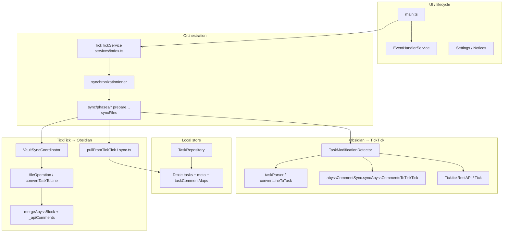
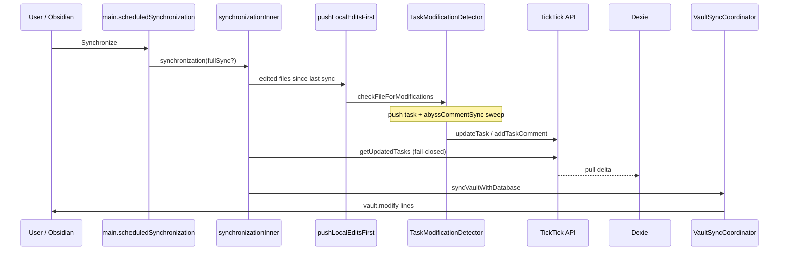
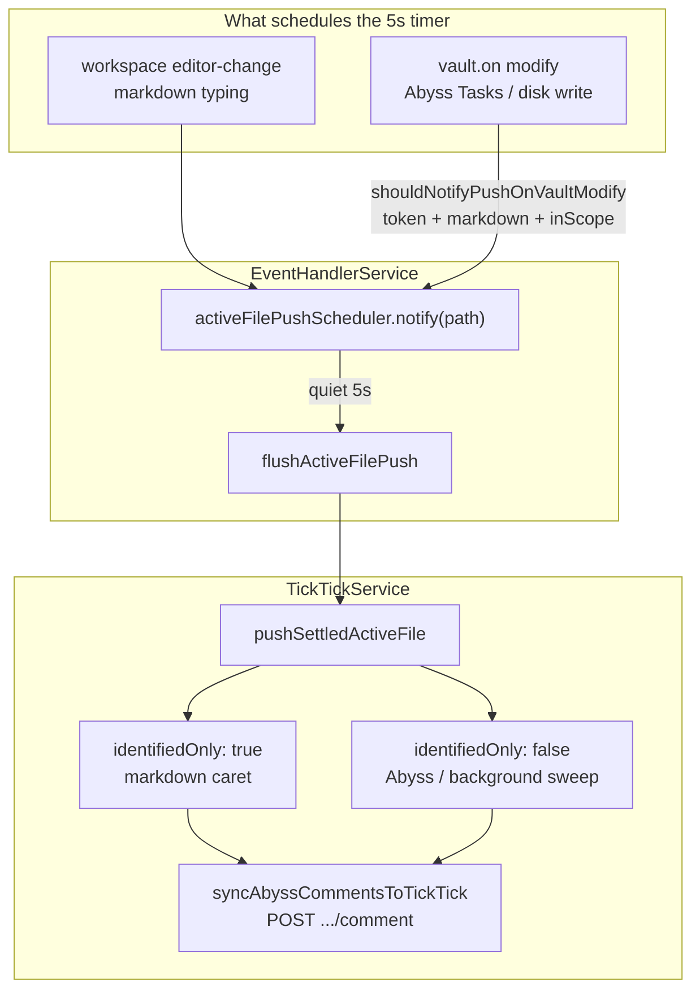
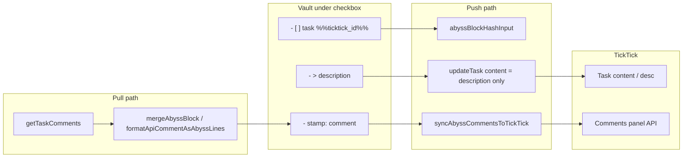

# Опорные схемы (аналитический мит 2026-10-19)

**Назначение:** перед правкой бага смотреть, **какой поток** затронут, и не ломать соседние границы. Детальный research-sync — в [`GTD_SYNC_RESEARCH.md`](../GTD_SYNC_RESEARCH.md) §3; delta/checkpoint/комментарии без N+1 — [`TICKTICK_DELTA_API.md`](TICKTICK_DELTA_API.md); smoke-IDs — [`SMOKE_TESTS.md`](../SMOKE_TESTS.md).

---

## 1. Analyst B — слои плагина (куда вносить diff)

**Phase modules (PR 1–2 / #31):** `prepare` → `projects` → `register` → `deletionGuard` → `push` → `pull` → `vaultReconcile` → `subtasks` → `syncFiles` (Phase 2 delete → `lifecycle/runVaultDeletionPhase`, `ctx.isPendingMarker`). Plan: [`SYNC_MODULARIZATION.md`](SYNC_MODULARIZATION.md). Bug routing by phase: vault lines → `vaultReconcile` / `VaultSyncCoordinator`; pre-pull vault edits → `push` / TMD; Dexie ingest → `pull` / `sync.ts`; false delete / pending marker → lifecycle + `SyncRunContext`.

| Если баг… | Править в первую очередь | Не трогать без нужды | Прогон |
|-----------|--------------------------|----------------------|--------|
| Комментарии не в TT **Comments** | `TaskModificationDetector`, `abyssCommentSync`, `EventHandlerService` / `activeFilePush` (Abyss `vault.modify`), `api/index` POST body | `VaultSyncCoordinator` routing, project scheme | `abyssCommentSync.test.ts`, `activeFilePush.test.ts`, NOTE-L3b; §2b + `BUG-COMMENT-API-POST-500` |
| Описание `- >` не в `content` | `taskParser`, `convertLineToTask` | `taskCommentMaps`, comment API | `notesSmoke.test.ts`, NOTE-L1 |
| Тихий sync / ложный «completed» | `api/index getUpdatedTasks`, `sync.ts`, `main synchronizeNow` | Dexie schema | `sync.test.ts` pull error |
| Delta / API rename не в vault / лишние `getTaskById` | `pull.ts` echo, `conflicts.ts`, `VaultSyncCoordinator vaultLineBehindTask`, `getUpdatedTasks` | Comment maps | `TICKTICK_DELTA_API.md`, `TEST_PLAN.md` TP-DELTA-* |
| Строка в vault устарела | `VaultSyncCoordinator`, `fileOperation` | Push hash в TMD | `syncSmoke`, pull tests |
| Дубли тегов | `contextTags`, `taskParser` push tags | Comment API | `contextTags.test.ts` CTX-D* |

**Правило:** не смешивать в одном MR **push-комментарии** и **маршрутизацию файлов** — разные аналитики, разные регрессии.

---

## 2. Analyst C — полный цикл Synchronize (порядок фаз)

| Фаза | Инвариант | Типичный баг |
|------|-----------|--------------|
| **Push до pull** | Локальные правки уходят до перезаписи vault | Потеря `[x]` / child lines |
| **Pull fail-closed** | Ошибка `getUpdatedTasks` → sync failed, checkpoint не «успех» | Пустая дельта, «всё синкнулось» |
| **Vault write** | LWW + `vaultLineBehindTask` для догонки | TT-only comment не в `.md` |
| **Active / open-note push** | После 5 с тишины: `editor-change` **или** in-scope `vault.modify` → Comments API | Abyss view без markdown leaf (**BUG-COMMENT-ABYSS-VIEW**) |

---

## 2b. Open-note push: markdown editor vs Abyss view

Два входа в один debounce (`ACTIVE_FILE_PUSH_DEBOUNCE_MS` = 5s → `pushSettledActiveFile` → `syncAbyssCommentsToTickTick`). POST body Comments API — отдельно (**2.0.74** / **BUG-COMMENT-API-POST-500**): без webapp-shaped body push всё равно 500.

| Источник правки | Событие Obsidian | Планирует 5s push? | Flush / sweep |
|-----------------|------------------|--------------------|---------------|
| Набор в markdown editor | `editor-change` | да | caret → `identifiedOnly: true` (comment line change still pushes parent) |
| Abyss Tasks view (остаётесь в Abyss) | `vault.modify` | да (**2.0.75**, **BUG-COMMENT-ABYSS-VIEW**) | не требует `getActiveFile() === path`; `identifiedOnly: false` |
| Полный **Synchronize** | `checkFileForModifications` | N/A (сразу) | `syncAllAbyssCommentsInFile` |

**Не путать:** запись плагина в vault при pull (`VaultSyncCoordinator` / `commitVaultText`) — это **не** пользовательский Abyss-edit; open-note scheduler слушает modify для in-scope заметок, но self-write / syncRunning откладывают flush.

---

## 3. Analyst A — Abyss block: описание vs комментарии (Phase 1 API)

**Границы данных (не ломать):**

| Сущность | Vault | TickTick task body | TickTick Comments API | Dexie `taskCommentMaps` |
|----------|-------|--------------------|------------------------|-------------------------|
| Описание `- >` | да | `content` | нет | нет |
| Комментарий `- date:` | да | **нет** (при API on) | `title` комментария | fingerprint ↔ tt comment id |
| Legacy `Comments:` в body | миграция | убирается при push | переносится в API | создаётся map |

**Триггеры push комментария (все должны оставаться рабочими):**

1. `checkLineForModifications` на **родительской** строке (hash / applyModifications).
2. Перенаправление с **дочерней** Abyss-строки на родителя (`findAbyssParentTaskLine`).
3. **`syncAllAbyssCommentsInFile`** в конце `checkFileForModifications` (полный Synchronize).
4. Debounced open-note push (`activeFilePushScheduler`): **`editor-change`** *или* in-scope **`vault.modify`** (Abyss view — §2b).
5. Успешный POST всё ещё требует webapp body (**BUG-COMMENT-API-POST-500** / **2.0.74**): `id`, `taskId`, `projectId`, `createdTime`, `title`, … — не `{ title }` alone.

**Перед коммитом при баге комментариев:** убедиться, что строка **есть на диске** (Abyss + Enter), затем либо подождать 5s open-note push, либо **Synchronize**; проверка — MCP `get_comment(project_id, task_id)`, не поле `content`.

---

## 4. Матрица «безопасная правка»

1. Найти ID бага в [`PO_STATUS.md`](../PO_STATUS.md) → столбец «суть».
2. Открыть схему выше (A / B / C).
3. Ограничить diff **одним подграфом** (Push *или* Pull *или* UI).
4. Добавить/обновить **один** targeted test (smoke ID из `SMOKE_TESTS.md`).
5. Не менять hash + API + routing в одном коммите без интеграционного теста.

---

## References

- [`PO_STATUS.md`](../PO_STATUS.md) — Problems / To Be Done
- [`CHANGELOG.md`](../CHANGELOG.md) — итерации
- [`ABYSS_NOTES_ALIGNMENT.md`](../ABYSS_NOTES_ALIGNMENT.md) — формат строк
- [`COMMENT_SYNC_MODEL.md`](COMMENT_SYNC_MODEL.md) — keys + push triggers (editor vs Abyss view)
- [`TICKTICK_DELTA_API.md`](TICKTICK_DELTA_API.md) — delta gaps + Comments POST shape
- [`GTD_SYNC_RESEARCH.md`](../GTD_SYNC_RESEARCH.md) — полный mermaid sync
